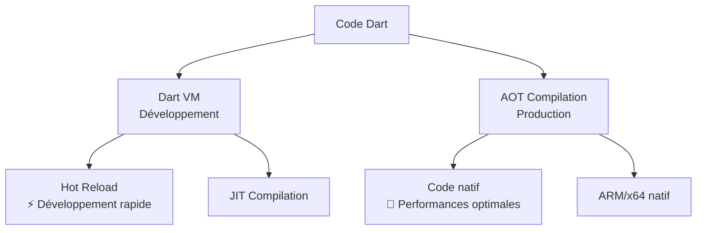
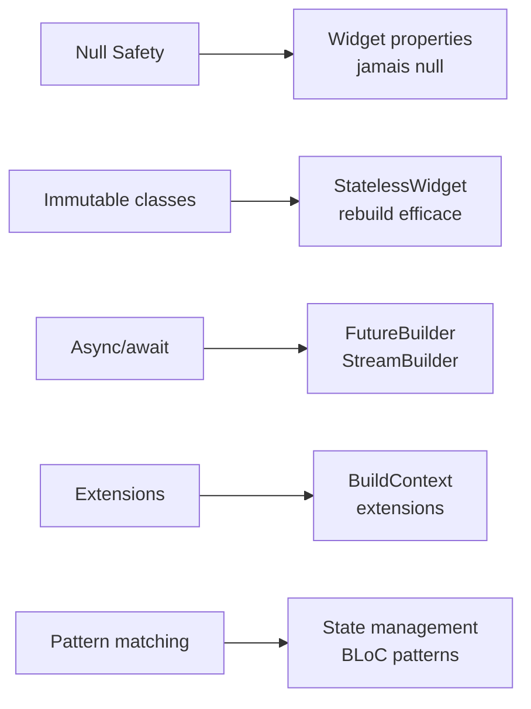
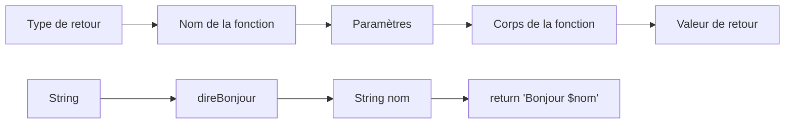
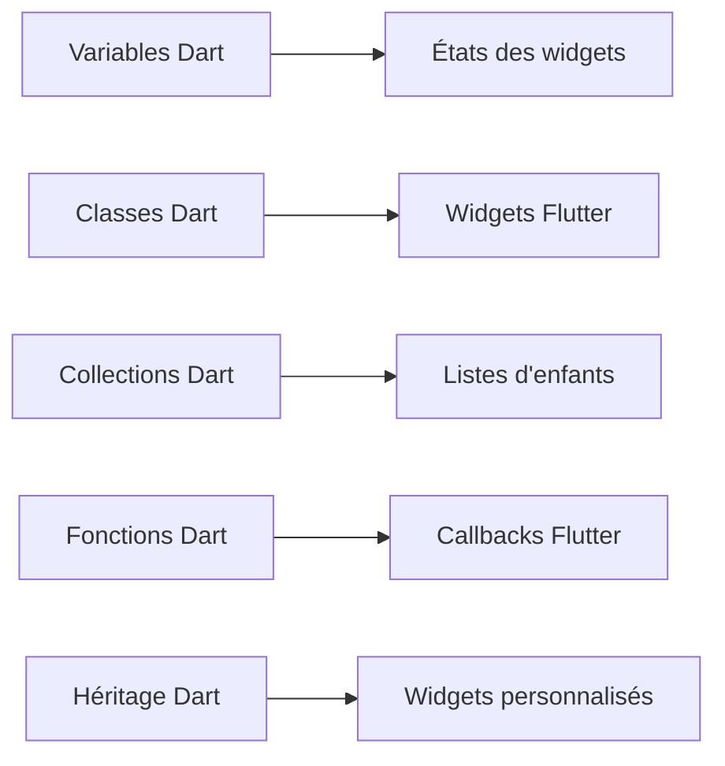

# Langage Dart – Fondamentaux pour Flutter

[[toc]]

## 🎯 Dart dans le contexte Flutter

Dart est le langage qui alimente Flutter. Conçu par Google, il combine la familiarité syntaxique de Java/C# avec les performances et la flexibilité nécessaires au développement mobile moderne.

### Architecture et compilation



**Avantages clés pour Flutter :**
- **Hot Reload** : Modifications instantanées sans perte d'état
- **AOT Compilation** : Performance native en production
- **Single Threading** : Modèle de concurrence simple avec isolates
- **Null Safety** : Élimination des NPE à la compilation

::: info 💡 Transition depuis Java/C#
Comme vous venez de Java ou C#, Dart vous semblera familier avec quelques améliorations modernes : inférence de type poussée, null safety par défaut, et syntaxe plus concise.
:::

## 🔤 Spécificités syntaxiques de Dart

### Déclaration et inférence de type

```dart
// Explicite vs inférence - les deux sont idiomatiques
String message = 'Hello Flutter';
var message2 = 'Hello Flutter';  // Type inféré : String

// Late initialization (utile pour les dépendances)
late String configValue;  // Initialisé plus tard, garanti non-null

// Nullable vs non-nullable (différence clé avec Java/C#)
String nonNull = 'Safe';      // Ne peut jamais être null
String? nullable = null;      // Peut être null
```

### Null Safety : la révolution Dart

```dart
class UserService {
  String? _cachedUser;  // Peut être null
  
  // Opérateurs null-aware
  String getUserName() {
    return _cachedUser?.toUpperCase() ?? 'ANONYMOUS';
    //                ^                ^
    //          safe navigation    null coalescing
  }
  
  // Null assertion (à utiliser avec précaution)
  String getGuaranteedUser() {
    return _cachedUser!;  // Je sais qu'il n'est pas null
  }
  
  // Pattern moderne avec promotion de type
  String processUser() {
    if (_cachedUser != null) {
      // Ici, _cachedUser est automatiquement promu à String
      return _cachedUser.toLowerCase();  // Pas besoin de ! ou ?
    }
    return 'No user';
  }
}
```

### Collections et génériques

```dart
// Collections typées avec inférence
var users = <String>['Alice', 'Bob'];  // List<String>
var ages = {'Alice': 25, 'Bob': 30};   // Map<String, int>
var uniqueIds = {1, 2, 3};             // Set<int>

// Spread operator et collection if/for
var allUsers = [
  'Admin',
  ...users,                    // Spread
  if (isDebug) 'DebugUser',   // Conditional
  for (var i in range) 'User$i', // Collection for
];

// Pattern matching avec collections
switch (users) {
  case []:
    print('No users');
  case [var single]:
    print('Single user: $single');
  case [var first, ...var rest]:
    print('First: $first, others: ${rest.length}');
}
```

## 🎭 Fonctions et closures

### Signatures de fonctions modernes

```dart
// Paramètres nommés requis (idiome Flutter)
Widget buildCard({
  required String title,
  required String content,
  VoidCallback? onTap,
  bool isSelected = false,
}) {
  // Implementation
}

// Fonctions d'ordre supérieur
typedef Validator<T> = String? Function(T value);

String? validateEmail(String email) {
  return email.contains('@') ? null : 'Invalid email';
}

// Extension methods (ajout de méthodes à des types existants)
extension StringValidation on String {
  bool get isValidEmail => contains('@') && contains('.');
  String get capitalize => isEmpty ? this : '${this[0].toUpperCase()}${substring(1)}';
}
```

### Programmation asynchrone : Future et Stream

```dart
// Future : une valeur unique dans le futur
Future<List<User>> fetchUsers() async {
  final response = await http.get(Uri.parse('/api/users'));
  return (json.decode(response.body) as List)
      .map((json) => User.fromJson(json))
      .toList();
}

// Stream : flux de valeurs
Stream<String> searchSuggestions(String query) async* {
  await Future.delayed(Duration(milliseconds: 300));
  
  for (var suggestion in await getSuggestions(query)) {
    yield suggestion;
  }
}

// Utilisation avec Flutter StreamBuilder
class SearchWidget extends StatelessWidget {
  final String query;
  
  Widget build(BuildContext context) {
    return StreamBuilder<String>(
      stream: searchSuggestions(query),
      builder: (context, snapshot) {
        if (snapshot.hasData) {
          return Text(snapshot.data!);
        }
        return CircularProgressIndicator();
      },
    );
  }
}
```

## 🏗️ Classes et patterns orientés Flutter

### Immutabilité et Value Objects

```dart
// Classe immutable (pattern Flutter)
@immutable
class User {
  final String id;
  final String name;
  final String email;
  
  const User({
    required this.id,
    required this.name,
    required this.email,
  });
  
  // Factory constructor pour JSON
  factory User.fromJson(Map<String, dynamic> json) {
    return User(
      id: json['id'],
      name: json['name'],
      email: json['email'],
    );
  }
  
  // CopyWith pour "modification" immutable
  User copyWith({
    String? id,
    String? name,
    String? email,
  }) {
    return User(
      id: id ?? this.id,
      name: name ?? this.name,
      email: email ?? this.email,
    );
  }
  
  // Equality et hashCode (ou utiliser equatable package)
  @override
  bool operator ==(Object other) =>
      identical(this, other) ||
      other is User &&
          runtimeType == other.runtimeType &&
          id == other.id;
          
  @override
  int get hashCode => id.hashCode;
}
```

### Mixins : composition plutôt qu'héritage

```dart
// Mixin pour fonctionnalités partagées
mixin TimestampMixin {
  DateTime? _createdAt;
  DateTime? _updatedAt;
  
  DateTime get createdAt => _createdAt ??= DateTime.now();
  DateTime get updatedAt => _updatedAt ??= DateTime.now();
  
  void touch() {
    _updatedAt = DateTime.now();
  }
}

mixin ValidationMixin {
  final List<String> _errors = [];
  
  List<String> get errors => List.unmodifiable(_errors);
  bool get isValid => _errors.isEmpty;
  
  void addError(String error) => _errors.add(error);
  void clearErrors() => _errors.clear();
}

// Utilisation des mixins
class BlogPost with TimestampMixin, ValidationMixin {
  final String title;
  final String content;
  
  BlogPost({required this.title, required this.content}) {
    _validate();
  }
  
  void _validate() {
    clearErrors();
    if (title.isEmpty) addError('Title required');
    if (content.length < 10) addError('Content too short');
  }
}
```

### Extensions : étendre les types existants

```dart
// Extensions pour types primitifs
extension DateTimeExtensions on DateTime {
  bool get isToday {
    final now = DateTime.now();
    return year == now.year && month == now.month && day == now.day;
  }
  
  String get timeAgo {
    final diff = DateTime.now().difference(this);
    if (diff.inDays > 0) return '${diff.inDays}d ago';
    if (diff.inHours > 0) return '${diff.inHours}h ago';
    return '${diff.inMinutes}m ago';
  }
}

// Extensions pour Flutter
extension BuildContextExtensions on BuildContext {
  ThemeData get theme => Theme.of(this);
  MediaQueryData get mediaQuery => MediaQuery.of(this);
  NavigatorState get navigator => Navigator.of(this);
  
  void showSnackBar(String message) {
    ScaffoldMessenger.of(this).showSnackBar(
      SnackBar(content: Text(message)),
    );
  }
}

// Utilisation
DateTime.now().isToday;  // true
context.showSnackBar('Hello!');
```

## 🔄 Patterns Dart essentiels pour Flutter

### Sealed Classes et Pattern Matching

```dart
// Union types avec sealed classes
sealed class ApiResult<T> {}

class Success<T> extends ApiResult<T> {
  final T data;
  Success(this.data);
}

class Loading<T> extends ApiResult<T> {}

class Error<T> extends ApiResult<T> {
  final String message;
  Error(this.message);
}

// Pattern matching exhaustif
Widget buildFromApiResult<T>(ApiResult<T> result) {
  return switch (result) {
    Success(data: var data) => DataWidget(data),
    Loading() => CircularProgressIndicator(),
    Error(message: var msg) => ErrorWidget(msg),
  };
}
```

### Records : tuples typés

```dart
// Records pour retourner plusieurs valeurs
(String, int, bool) getUserInfo() {
  return ('Alice', 25, true);
}

// Avec noms de champs
({String name, int age, bool isActive}) getUserInfoNamed() {
  return (name: 'Alice', age: 25, isActive: true);
}

// Destructuring
final (name, age, isActive) = getUserInfo();
final userInfo = getUserInfoNamed();
print('User: ${userInfo.name}');
```

### Error Handling idiomatique

```dart
// Result type pattern
abstract class Result<T, E> {
  const Result();
}

class Ok<T, E> extends Result<T, E> {
  final T value;
  const Ok(this.value);
}

class Err<T, E> extends Result<T, E> {
  final E error;
  const Err(this.error);
}

// Service avec gestion d'erreur typée
class UserService {
  Future<Result<User, ApiError>> getUser(String id) async {
    try {
      final response = await http.get(Uri.parse('/users/$id'));
      if (response.statusCode == 200) {
        return Ok(User.fromJson(json.decode(response.body)));
      } else {
        return Err(ApiError.fromStatusCode(response.statusCode));
      }
    } catch (e) {
      return Err(ApiError.network(e.toString()));
    }
  }
}

// Utilisation
final result = await userService.getUser('123');
switch (result) {
  case Ok(value: var user):
    print('User: ${user.name}');
  case Err(error: var error):
    print('Error: ${error.message}');
}
```

## 🚀 Connexion avec Flutter

Ces concepts Dart s'articulent directement avec Flutter :



### Exemple : Widget avec tous les concepts

```dart
@immutable
class UserCard extends StatelessWidget {
  final User user;
  final VoidCallback? onTap;
  
  const UserCard({
    required this.user,
    this.onTap,
    super.key,
  });
  
  @override
  Widget build(BuildContext context) {
    return Card(
      child: ListTile(
        leading: CircleAvatar(
          child: Text(user.name.firstChar),
        ),
        title: Text(user.name.capitalize),
        subtitle: Text(user.createdAt.timeAgo),
        trailing: switch (user.status) {
          UserStatus.online => Icon(Icons.circle, color: Colors.green),
          UserStatus.away => Icon(Icons.circle, color: Colors.orange),
          UserStatus.offline => Icon(Icons.circle, color: Colors.grey),
        },
        onTap: onTap,
      ),
    );
  }
}
```

::: tip 🎯 Prochaine étape
Maintenant que vous maîtrisez les spécificités de Dart, découvrez la [syntaxe avancée](./syntaxe-avancee.md) pour les patterns plus sophistiqués, puis plongez dans [Flutter](../flutter/) pour voir ces concepts en action !
:::

## 📚 Ressources complémentaires

- **Null Safety** : Comprendre les opérateurs `?.`, `??`, `!`
- **Async/Await** : Maîtriser Future et Stream pour les APIs
- **Extensions** : Étendre les types existants proprement
- **Pattern Matching** : Nouvelle syntaxe Dart 3.0 pour le contrôle de flux
- **Mixins** : Composition vs héritage pour la réutilisation de code
::: tip 💡 L'interpolation : votre meilleur ami
L'interpolation avec `$` est l'une des fonctionnalités les plus utilisées en Dart. Elle rend votre code plus lisible que la concaténation traditionnelle.
:::

### Les booléens : logique simple

```dart
void exempleBooleens() {
  bool estMajeur = true;
  bool aPermis = false;
  
  // Opérations logiques
  bool peutConduire = estMajeur && aPermis;  // ET logique
  bool peutVoter = estMajeur || false;       // OU logique
  bool estMineur = !estMajeur;               // NON logique
  
  print('Peut conduire: $peutConduire');
}
```

## 🔄 Contrôle de flux : prendre des décisions

Maintenant que vous maîtrisez les types de base, apprenons à prendre des décisions dans votre code.

### Conditions : if, else if, else

```dart
void exempleConditions() {
  int note = 15;
  
  if (note >= 16) {
    print('Excellent !');
  } else if (note >= 14) {
    print('Très bien');
  } else if (note >= 12) {
    print('Bien');
  } else if (note >= 10) {
    print('Passable');
  } else {
    print('Insuffisant');
  }
}
```

### Le switch : quand if devient répétitif

```dart
void exempleSwitch() {
  String grade = 'B';
  
  switch (grade) {
    case 'A':
      print('Excellent travail !');
      break;
    case 'B':
      print('Bon travail');
      break;
    case 'C':
      print('Travail acceptable');
      break;
    default:
      print('Grade non reconnu');
  }
}
```

### Boucles : répéter sans se lasser

```dart
void exempleBoucles() {
  // Boucle for classique
  print('Comptage de 1 à 5:');
  for (int i = 1; i <= 5; i++) {
    print('Nombre: $i');
  }
  
  // Boucle while
  print('\nCountdown:');
  int countdown = 5;
  while (countdown > 0) {
    print(countdown);
    countdown--;
  }
  print('Décollage ! 🚀');
}
```

## 📚 Collections : organiser vos données

Les collections sont essentielles pour gérer plusieurs éléments. Dart offre trois types principaux.

```mermaid
graph TD
    A[Collections Dart] --> B[List<br/>Listes ordonnées]
    A --> C[Set<br/>Ensembles uniques]
    A --> D[Map<br/>Clé-Valeur]
    
    B --> E[fruits[0] = 'pomme']
    C --> F[{1, 2, 3} - pas de doublons]
    D --> G[ages['Alice'] = 25]
```

### Lists : vos tableaux dynamiques

```dart
void exempleListes() {
  // Création d'une liste
  List<String> fruits = ['pomme', 'banane', 'orange'];
  
  // Ou avec inférence de type
  var legumes = ['carotte', 'poivron', 'tomate'];
  
  // Ajouter des éléments
  fruits.add('kiwi');
  fruits.addAll(['mangue', 'ananas']);
  
  // Accéder aux éléments
  print('Premier fruit: ${fruits[0]}');
  print('Dernier fruit: ${fruits.last}');
  print('Nombre de fruits: ${fruits.length}');
  
  // Parcourir la liste
  print('\nTous les fruits:');
  for (String fruit in fruits) {
    print('- $fruit');
  }
}
```

### Sets : collections sans doublons

```dart
void exempleSets() {
  // Création d'un set
  Set<int> nombresPairs = {2, 4, 6, 8};
  
  // Tentative d'ajout d'un doublon
  nombresPairs.add(4);  // N'aura aucun effet
  nombresPairs.add(10); // Sera ajouté
  
  print('Nombres pairs: $nombresPairs');
  print('Contient 6? ${nombresPairs.contains(6)}');
}
```

### Maps : vos dictionnaires

```dart
void exempleMaps() {
  // Création d'une map (dictionnaire)
  Map<String, int> ages = {
    'Alice': 25,
    'Bob': 30,
    'Charlie': 35,
  };
  
  // Ajouter/modifier des entrées
  ages['Diana'] = 28;
  ages['Alice'] = 26;  // Modification
  
  // Accéder aux valeurs
  print('Age d\'Alice: ${ages['Alice']}');
  
  // Parcourir la map
  print('\nTous les âges:');
  ages.forEach((nom, age) => print('$nom a $age ans'));
}
```

## 🎯 Fonctions : vos premiers outils réutilisables

Les fonctions sont le cœur de la programmation. Elles permettent de découper votre code en blocs réutilisables.

### Anatomie d'une fonction



### Fonctions de base

```dart
// Fonction simple avec retour
String calculerMessage(String nom, int age) {
  return 'Bonjour $nom, vous avez $age ans';
}

// Fonction sans retour (void)
void afficherMessage(String message) {
  print('📧 $message');
}

// Fonction avec syntaxe fléchée (pour les expressions simples)
int doubler(int nombre) => nombre * 2;
String majuscules(String texte) => texte.toUpperCase();
```

### Paramètres optionnels et nommés

```dart
// Paramètres optionnels positionnels
String saluer(String nom, [String salutation = 'Bonjour']) {
  return '$salutation $nom !';
}

// Paramètres nommés
String creerProfil({
  required String nom,        // Obligatoire
  required int age,          // Obligatoire
  String ville = 'Inconnue', // Optionnel avec valeur par défaut
  bool estPublic = false,    // Optionnel avec valeur par défaut
}) {
  String visibilite = estPublic ? 'public' : 'privé';
  return 'Profil $visibilite: $nom ($age ans) à $ville';
}

void exempleUtilisation() {
  // Utilisation des fonctions
  print(saluer('Alice'));                    // Bonjour Alice !
  print(saluer('Bob', 'Bonsoir'));          // Bonsoir Bob !
  
  print(creerProfil(
    nom: 'Charlie',
    age: 25,
    ville: 'Paris',
    estPublic: true,
  ));
}
```
## 🏗️ Programmation Orientée Objet : créer vos propres types

Maintenant que vous maîtrisez les fondamentaux, passons au niveau supérieur : créer vos propres types de données avec les classes.

### Pourquoi les classes ?

Imaginez que vous développez une app de gestion d'étudiants. Au lieu de jongler avec des variables séparées :

```dart
// ❌ Approche chaotique
String nomEtudiant1 = 'Alice';
int ageEtudiant1 = 20;
String emailEtudiant1 = 'alice@email.com';

String nomEtudiant2 = 'Bob';
int ageEtudiant2 = 22;
String emailEtudiant2 = 'bob@email.com';
```

Vous pouvez créer un type `Etudiant` :

```dart
// ✅ Approche structurée
class Etudiant {
  String nom;
  int age;
  String email;
  
  Etudiant(this.nom, this.age, this.email);
}

// Utilisation
var alice = Etudiant('Alice', 20, 'alice@email.com');
var bob = Etudiant('Bob', 22, 'bob@email.com');
```

### Anatomie d'une classe

```mermaid
graph TD
    A[Classe Etudiant] --> B[Propriétés<br/>nom, age, email]
    A --> C[Constructeur<br/>Etudiant(...)]
    A --> D[Méthodes<br/>sePresenter(), estMajeur()]
    
    B --> E[État de l'objet]
    C --> F[Création d'instances]
    D --> G[Comportements]
```

### Votre première classe complète

```dart
class Etudiant {
  // Propriétés (attributs)
  String nom;
  int age;
  String email;
  List<String> cours = [];
  
  // Constructeur principal
  Etudiant(this.nom, this.age, this.email);
  
  // Constructeur nommé
  Etudiant.avecCours(this.nom, this.age, this.email, this.cours);
  
  // Méthodes (comportements)
  void sePresenter() {
    print('Bonjour, je suis $nom, j\'ai $age ans');
  }
  
  bool estMajeur() => age >= 18;
  
  void inscrireCours(String cours) {
    this.cours.add(cours);
    print('$nom est inscrit à $cours');
  }
  
  void afficherCours() {
    if (cours.isEmpty) {
      print('$nom n\'est inscrit à aucun cours');
    } else {
      print('Cours de $nom: ${cours.join(', ')}');
    }
  }
  
  // Getter et setter
  String get presentation => '$nom ($age ans)';
  
  set nouveauEmail(String email) {
    if (email.contains('@')) {
      this.email = email;
    } else {
      print('Email invalide !');
    }
  }
}
```

### Utilisation pratique

```dart
void exempleEtudiants() {
  // Création d'étudiants
  var alice = Etudiant('Alice', 20, 'alice@email.com');
  var bob = Etudiant.avecCours(
    'Bob', 22, 'bob@email.com', ['Programmation', 'Mathématiques']
  );
  
  // Utilisation des méthodes
  alice.sePresenter();
  alice.inscrireCours('Flutter');
  alice.inscrireCours('Dart');
  alice.afficherCours();
  
  // Utilisation des getters/setters
  print('Présentation: ${alice.presentation}');
  alice.nouveauEmail = 'alice.nouvel@email.com';
  
  // Vérification
  if (alice.estMajeur()) {
    print('${alice.nom} peut voter !');
  }
}
```

### Héritage : spécialiser vos classes

Supposons que vous ayez différents types d'étudiants :

```dart
// Classe de base
abstract class Personne {
  String nom;
  int age;
  
  Personne(this.nom, this.age);
  
  void sePresenter() {
    print('Je suis $nom, j\'ai $age ans');
  }
  
  // Méthode abstraite (doit être implémentée)
  String get role;
}

// Classes spécialisées
class Etudiant extends Personne {
  String niveau;
  List<String> cours = [];
  
  Etudiant(String nom, int age, this.niveau) : super(nom, age);
  
  @override
  String get role => 'Étudiant en $niveau';
  
  @override
  void sePresenter() {
    super.sePresenter();
    print('Je suis en $niveau');
  }
}

class Professeur extends Personne {
  String matiere;
  List<String> coursEnseignes = [];
  
  Professeur(String nom, int age, this.matiere) : super(nom, age);
  
  @override
  String get role => 'Professeur de $matiere';
  
  void donnerCours(String cours) {
    coursEnseignes.add(cours);
    print('$nom donne le cours: $cours');
  }
}
```

### Polymorphisme en action

```dart
void exemplePolymorphisme() {
  List<Personne> universite = [
    Etudiant('Alice', 20, 'BAC 3'),
    Professeur('Dr. Martin', 45, 'Informatique'),
    Etudiant('Bob', 19, 'BAC 2'),
  ];
  
  // Chaque personne se présente selon son type
  for (Personne personne in universite) {
    personne.sePresenter();
    print('Rôle: ${personne.role}');
    print('---');
  }
}
```

::: tip 🎯 Concepts clés à retenir
- **Encapsulation** : Les données et méthodes sont groupées dans la classe
- **Héritage** : Une classe peut hériter d'une autre (extends)
- **Polymorphisme** : Un objet peut prendre plusieurs formes
- **Abstraction** : Cacher la complexité derrière une interface simple
:::

## 🚀 Vers Flutter : pourquoi ces concepts sont essentiels

Tous ces concepts Dart que vous venez d'apprendre sont **directement utilisés** dans Flutter :



### Exemple concret : un widget Flutter

```dart
// Cette classe hérite de StatelessWidget (concept d'héritage)
class MonBouton extends StatelessWidget {
  final String texte;        // Propriété (concept de classe)
  final VoidCallback onTap;  // Fonction callback
  
  // Constructeur avec paramètres nommés
  const MonBouton({
    required this.texte,
    required this.onTap,
    Key? key,
  }) : super(key: key);
  
  @override  // Polymorphisme
  Widget build(BuildContext context) {
    return GestureDetector(
      onTap: onTap,
      child: Container(
        padding: EdgeInsets.all(16),
        decoration: BoxDecoration(
          color: Colors.blue,
          borderRadius: BorderRadius.circular(8),
        ),
        child: Text(texte),  // Interpolation de la propriété
      ),
    );
  }
}
```

::: info 🔗 Connexion avec Flutter
Dans le [chapitre Flutter](/flutter/), vous verrez comment ces concepts Dart s'assemblent pour créer des interfaces utilisateur magnifiques !
:::

## 📝 Exercice pratique : Système de bibliothèque

Créons ensemble un mini-système de gestion de bibliothèque qui utilise tous les concepts appris :

```dart
// Classe de base pour les items de la bibliothèque
abstract class ItemBibliotheque {
  String titre;
  String auteur;
  int anneePublication;
  bool estEmprunte = false;
  
  ItemBibliotheque(this.titre, this.auteur, this.anneePublication);
  
  void emprunter() {
    if (!estEmprunte) {
      estEmprunte = true;
      print('$titre a été emprunté');
    } else {
      print('$titre est déjà emprunté');
    }
  }
  
  void retourner() {
    if (estEmprunte) {
      estEmprunte = false;
      print('$titre a été retourné');
    } else {
      print('$titre n\'était pas emprunté');
    }
  }
  
  String get statut => estEmprunte ? 'Emprunté' : 'Disponible';
  
  // Méthode abstraite
  String get typeItem;
}

// Classes spécialisées
class Livre extends ItemBibliotheque {
  int nombrePages;
  String genre;
  
  Livre(String titre, String auteur, int annee, this.nombrePages, this.genre)
      : super(titre, auteur, annee);
  
  @override
  String get typeItem => 'Livre';
  
  @override
  String toString() {
    return '$typeItem: $titre par $auteur ($anneePublication) - $nombrePages pages - Genre: $genre - $statut';
  }
}

class DVD extends ItemBibliotheque {
  int dureeMinutes;
  String genre;
  
  DVD(String titre, String realisateur, int annee, this.dureeMinutes, this.genre)
      : super(titre, realisateur, annee);
  
  @override
  String get typeItem => 'DVD';
  
  @override
  String toString() {
    return '$typeItem: $titre réalisé par $auteur ($anneePublication) - ${dureeMinutes}min - Genre: $genre - $statut';
  }
}

// Classe pour gérer la bibliothèque
class Bibliotheque {
  List<ItemBibliotheque> items = [];
  
  void ajouterItem(ItemBibliotheque item) {
    items.add(item);
    print('${item.titre} ajouté à la bibliothèque');
  }
  
  List<ItemBibliotheque> rechercherParTitre(String titre) {
    return items.where((item) => 
      item.titre.toLowerCase().contains(titre.toLowerCase())
    ).toList();
  }
  
  List<ItemBibliotheque> get itemsDisponibles {
    return items.where((item) => !item.estEmprunte).toList();
  }
  
  void afficherInventaire() {
    print('\n=== INVENTAIRE DE LA BIBLIOTHÈQUE ===');
    if (items.isEmpty) {
      print('Aucun item dans la bibliothèque');
      return;
    }
    
    items.forEach((item) => print(item));
  }
}

// Utilisation
void main() {
  var bibliotheque = Bibliotheque();
  
  // Ajout d'items
  bibliotheque.ajouterItem(Livre('1984', 'George Orwell', 1949, 328, 'Dystopie'));
  bibliotheque.ajouterItem(Livre('Le Seigneur des Anneaux', 'J.R.R. Tolkien', 1954, 1216, 'Fantasy'));
  bibliotheque.ajouterItem(DVD('Inception', 'Christopher Nolan', 2010, 148, 'Science-Fiction'));
  
  // Affichage
  bibliotheque.afficherInventaire();
  
  // Emprunts
  var livre1984 = bibliotheque.items[0];
  livre1984.emprunter();
  
  // Recherche
  print('\n=== RECHERCHE "seigneur" ===');
  var resultats = bibliotheque.rechercherParTitre('seigneur');
  resultats.forEach((item) => print(item));
  
  // Items disponibles
  print('\n=== ITEMS DISPONIBLES ===');
  bibliotheque.itemsDisponibles.forEach((item) => print(item));
}
```

::: success 🎉 Félicitations !
Vous maîtrisez maintenant les fondamentaux de Dart ! Ce système de bibliothèque utilise :
- Classes et héritage
- Propriétés et méthodes
- Collections (List)
- Getters et overrides
- Méthodes abstraites
- Polymorphisme

Ces concepts sont **exactement** ceux que vous utiliserez dans Flutter !
:::

## 🔗 Prochaine étape

Maintenant que vous avez une base solide en Dart, vous êtes prêt à découvrir la [syntaxe avancée](./syntaxe-avancee.md) qui vous permettra d'écrire du code encore plus élégant et puissant !

Les concepts avancés que nous verrons incluent :
- La programmation asynchrone (async/await)
- La null safety avancée
- Les extensions et mixins
- Les génériques
- La gestion d'erreurs

Rendez-vous dans le prochain chapitre ! 🚀

// Opérations sur les listes
fruits.add('kiwi');
fruits.addAll(['mangue', 'ananas']);
fruits.insert(1, 'fraise');
fruits.remove('banane');
fruits.removeAt(0);

// Accès aux éléments
print(fruits[0]);        // Premier élément
print(fruits.length);    // Taille de la liste
print(fruits.isEmpty);   // Vérifie si vide
print(fruits.contains('pomme')); // Vérifie la présence

// Méthodes utiles
var majuscules = fruits.map((fruit) => fruit.toUpperCase()).toList();
var fruitsA = fruits.where((fruit) => fruit.startsWith('a')).toList();
var premiers3 = fruits.take(3).toList();
```

### Maps (Map)

```dart
// Création de maps
Map<String, int> ages = {
  'Alice': 25,
  'Bob': 30,
  'Charlie': 28
};

// Ajout et modification
ages['Diana'] = 26;
ages['Alice'] = 26;  // Modification

// Accès aux données
print(ages['Bob']);           // 30
print(ages['Zoe'] ?? 0);      // 0 si n'existe pas

// Itération
ages.forEach((nom, age) {
  print('$nom a $age ans');
});

// Méthodes utiles
List<String> noms = ages.keys.toList();
List<int> listeAges = ages.values.toList();
bool contientAlice = ages.containsKey('Alice');
```

### Sets (Set)

```dart
// Création de sets (éléments uniques)
Set<String> couleurs = {'rouge', 'vert', 'bleu'};
var nombres = {1, 2, 3, 2, 1}; // {1, 2, 3} - pas de doublons

// Opérations
couleurs.add('jaune');
couleurs.remove('rouge');
bool contientVert = couleurs.contains('vert');

// Opérations sur les ensembles
Set<int> set1 = {1, 2, 3};
Set<int> set2 = {2, 3, 4};

Set<int> union = set1.union(set2);         // {1, 2, 3, 4}
Set<int> intersection = set1.intersection(set2); // {2, 3}
Set<int> difference = set1.difference(set2);     // {1}
```

## 🏗️ Classes et programmation orientée objet

### Classes de base

```dart
class Personne {
  // Propriétés
  String nom;
  int age;
  
  // Constructeur
  Personne(this.nom, this.age);
  
  // Constructeur nommé
  Personne.bebe(this.nom) : age = 0;
  
  // Méthodes
  void sePresenter() {
    print('Je suis $nom et j\'ai $age ans');
  }
  
  bool estMajeur() => age >= 18;
  
  // Getter et setter
  String get description => '$nom ($age ans)';
  
  set nouveauNom(String nom) {
    this.nom = nom;
  }
}

// Utilisation
var alice = Personne('Alice', 25);
alice.sePresenter();
print(alice.estMajeur());

var bebe = Personne.bebe('Charlie');
print(bebe.description);
```

### Héritage

```dart
class Etudiant extends Personne {
  String universite;
  List<String> cours = [];
  
  Etudiant(String nom, int age, this.universite) : super(nom, age);
  
  @override
  void sePresenter() {
    super.sePresenter();
    print('J\'étudie à $universite');
  }
  
  void ajouterCours(String cours) {
    this.cours.add(cours);
  }
  
  void afficherCours() {
    print('Cours suivis: ${cours.join(', ')}');
  }
}

// Utilisation
var etudiant = Etudiant('Bob', 20, 'ULB');
etudiant.sePresenter();
etudiant.ajouterCours('Programmation mobile');
etudiant.afficherCours();
```

### Interfaces et classes abstraites

```dart
// Interface (contrat)
abstract class Volant {
  void voler();
  void atterrir();
}

// Classe abstraite
abstract class Animal {
  String nom;
  
  Animal(this.nom);
  
  void dormir() {
    print('$nom dort');
  }
  
  // Méthode abstraite
  void faireDuBruit();
}

// Implémentation
class Oiseau extends Animal implements Volant {
  Oiseau(String nom) : super(nom);
  
  @override
  void faireDuBruit() {
    print('$nom chante');
  }
  
  @override
  void voler() {
    print('$nom vole dans le ciel');
  }
  
  @override
  void atterrir() {
    print('$nom se pose');
  }
}
```

### Mixins

```dart
mixin Nageur {
  void nager() {
    print('Je nage !');
  }
}

mixin Coureur {
  void courir() {
    print('Je cours !');
  }
}

class Athlete extends Personne with Nageur, Coureur {
  String sport;
  
  Athlete(String nom, int age, this.sport) : super(nom, age);
  
  void entrainer() {
    print('$nom s\'entraîne en $sport');
    if (sport == 'natation') nager();
    if (sport == 'course') courir();
  }
}
```

## ⚡ Programmation asynchrone

### Futures

```dart
// Future simple
Future<String> telechargerDonnees() async {
  // Simulation d'une opération asynchrone
  await Future.delayed(Duration(seconds: 2));
  return 'Données téléchargées !';
}

// Utilisation avec async/await
void main() async {
  print('Début du téléchargement...');
  
  try {
    String resultat = await telechargerDonnees();
    print(resultat);
  } catch (e) {
    print('Erreur: $e');
  }
  
  print('Téléchargement terminé');
}

// Future avec gestion d'erreur
Future<int> diviser(int a, int b) async {
  if (b == 0) {
    throw ArgumentError('Division par zéro');
  }
  return a ~/ b;
}
```

### Streams

```dart
// Stream simple
Stream<int> compteur() async* {
  for (int i = 1; i <= 5; i++) {
    await Future.delayed(Duration(seconds: 1));
    yield i;
  }
}

// Écouter un stream
void main() async {
  await for (int valeur in compteur()) {
    print('Valeur: $valeur');
  }
}

// Stream avec StreamController
import 'dart:async';

class MessageService {
  final StreamController<String> _controller = StreamController<String>();
  
  Stream<String> get messages => _controller.stream;
  
  void envoyerMessage(String message) {
    _controller.add(message);
  }
  
  void fermer() {
    _controller.close();
  }
}
```

## 📋 Parsing JSON et manipulation de données

### Parsing JSON basique

```dart
import 'dart:convert';

// JSON vers Map
String jsonString = '{"nom": "Alice", "age": 25, "actif": true}';
Map<String, dynamic> userData = json.decode(jsonString);

print(userData['nom']);  // Alice
print(userData['age']);  // 25

// Map vers JSON
Map<String, dynamic> user = {
  'nom': 'Bob',
  'age': 30,
  'email': 'bob@example.com'
};
String jsonOutput = json.encode(user);
print(jsonOutput);
```

### Modèles de données avec JSON

```dart
class Utilisateur {
  final String nom;
  final int age;
  final String email;
  final bool actif;
  
  Utilisateur({
    required this.nom,
    required this.age,
    required this.email,
    this.actif = true,
  });
  
  // Factory constructor pour créer depuis JSON
  factory Utilisateur.fromJson(Map<String, dynamic> json) {
    return Utilisateur(
      nom: json['nom'] as String,
      age: json['age'] as int,
      email: json['email'] as String,
      actif: json['actif'] as bool? ?? true,
    );
  }
  
  // Convertir vers JSON
  Map<String, dynamic> toJson() {
    return {
      'nom': nom,
      'age': age,
      'email': email,
      'actif': actif,
    };
  }
  
  @override
  String toString() {
    return 'Utilisateur(nom: $nom, age: $age, email: $email)';
  }
}

// Utilisation
String jsonData = '''
{
  "nom": "Alice Dupont",
  "age": 28,
  "email": "alice@example.com",
  "actif": true
}
''';

Utilisateur user = Utilisateur.fromJson(json.decode(jsonData));
print(user); // Utilisateur(nom: Alice Dupont, age: 28, email: alice@example.com)

String backToJson = json.encode(user.toJson());
print(backToJson);
```

## 🔄 Comparaisons avec Java et C#

### Syntaxe similaire

| Concept | Java | C# | Dart |
|---------|------|----|----- |
| Déclaration variable | `String nom = "Alice";` | `string nom = "Alice";` | `String nom = 'Alice';` |
| Classe | `public class Person` | `public class Person` | `class Person` |
| Héritage | `extends` | `:` | `extends` |
| Interface | `implements` | `:` | `implements` |
| Null check | `if (obj != null)` | `if (obj != null)` | `obj != null` ou `obj?` |

### Différences notables

```dart
// Dart - Constructeurs simplifiés
class Point {
  double x, y;
  Point(this.x, this.y);  // Plus concis qu'en Java/C#
}

// Dart - Getters/Setters automatiques
class Rectangle {
  double width, height;
  Rectangle(this.width, this.height);
  
  double get area => width * height;  // Getter calculé
  set area(double value) => width = value / height;  // Setter
}

// Dart - Null safety native
String? nom;  // Peut être null
String nomNonNull = nom ?? 'Défaut';  // Opérateur null-coalescing
```

::: warning Points d'attention
- Dart est case-sensitive (comme Java, contrairement à certains langages)
- Les conventions de nommage suivent le camelCase pour les variables et méthodes
- Le point-virgule est obligatoire à la fin des instructions
:::

## 🏃‍♀️ Exercices pratiques

### Exercice 1: Calculatrice simple

```dart
class Calculatrice {
  double addition(double a, double b) => a + b;
  double soustraction(double a, double b) => a - b;
  double multiplication(double a, double b) => a * b;
  
  double division(double a, double b) {
    if (b == 0) throw ArgumentError('Division par zéro');
    return a / b;
  }
  
  List<double> historique = [];
  
  void ajouterAuHistorique(double resultat) {
    historique.add(resultat);
  }
  
  void afficherHistorique() {
    print('Historique: ${historique.join(', ')}');
  }
}
```

### Exercice 2: Gestion d'une liste de tâches

```dart
enum StatutTache { enAttente, enCours, terminee }

class Tache {
  String titre;
  String description;
  DateTime dateCreation;
  StatutTache statut;
  
  Tache({
    required this.titre,
    required this.description,
    DateTime? dateCreation,
    this.statut = StatutTache.enAttente,
  }) : dateCreation = dateCreation ?? DateTime.now();
  
  void marquerTerminee() {
    statut = StatutTache.terminee;
  }
  
  @override
  String toString() {
    return '$titre (${statut.name}) - $description';
  }
}

class GestionnaireTaches {
  List<Tache> taches = [];
  
  void ajouterTache(Tache tache) {
    taches.add(tache);
  }
  
  List<Tache> obtenirTachesParStatut(StatutTache statut) {
    return taches.where((tache) => tache.statut == statut).toList();
  }
  
  void afficherTaches() {
    for (var tache in taches) {
      print(tache);
    }
  }
}
```

Cette introduction aux fondamentaux de Dart vous donne les bases nécessaires pour aborder Flutter. Dans la prochaine section, nous explorerons la [syntaxe avancée de Dart](./syntaxe-avancee.md) qui vous permettra de maîtriser pleinement le langage.