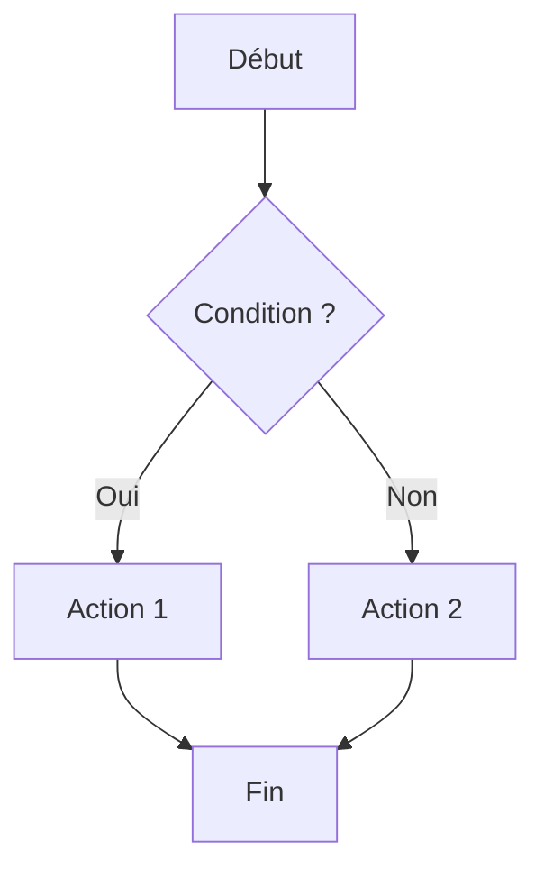
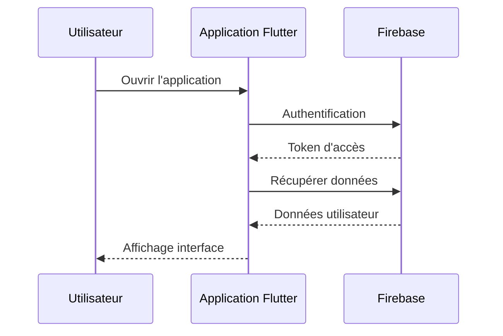
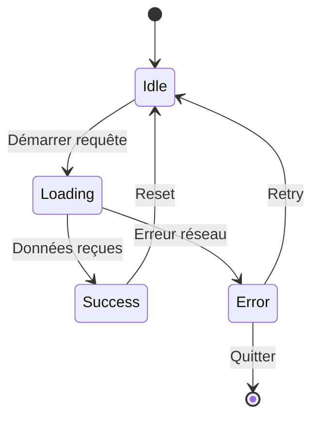
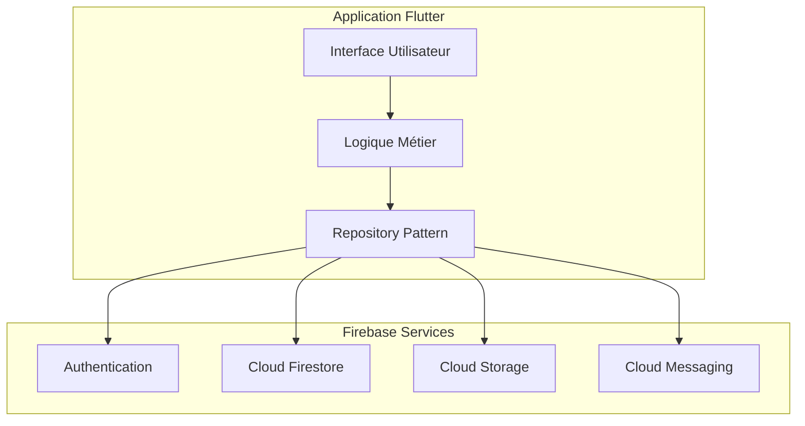

# Test Mermaid

Ce fichier est un test pour vérifier que les diagrammes Mermaid fonctionnent correctement.

## Diagramme de flux simple

## Diagramme de séquence

## Diagramme d'état

## Architecture Flutter avec Firebase

